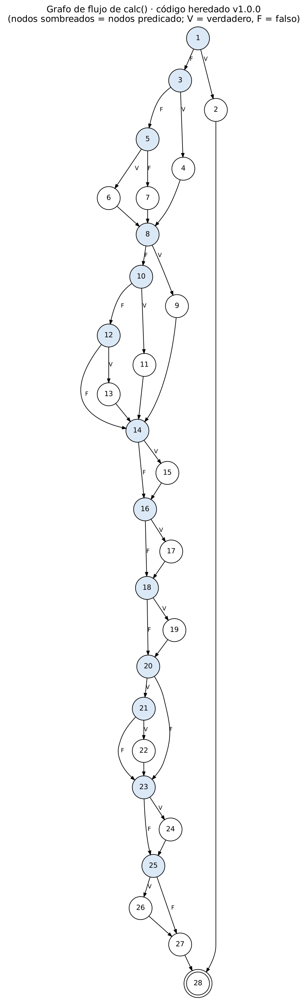

# Parcial 3 · Ingeniería de Software I — EnvíaYa

**Estudiante:** _vicente rivadeneira_
**Código estudiantil:** 0182220060
**Repositorio:** https://github.com/Vicenz111/envios-ya

## Mis parámetros

Últimos 6 dígitos del código: **220060**

| A | B | C | D | E | F | PMAX   | L1   | L2    | RR   | RN   | V    | S      | CAMBIO |
|---|---|---|---|---|---|------  |----  |----   |----  |----  |---   |---     |--------|
| 2 | 2 | 0 | 0 | 6 | 0 | 40 kg  | 4 kg | 10 kg | 20 % | 40 % | 20 % | $2.000 | 2 (hora pico) |

| Parámetro | Fórmula | Cálculo | Valor |
|---|---|---|---|
| PMAX | 30 + 5·A | 30 + 5·2 | 40 kg |
| L1 | 2 + (B mod 3) | 2 + (2 mod 3) = 2 + 2 | 4 kg |
| L2 | 10 + C | 10 + 0 | 10 kg |
| RR | 10 + 5·(E mod 4) | 10 + 5·(6 mod 4) = 10 + 5·2 | 20 % |
| RN | 40 + 5·(F mod 3) | 40 + 5·(0 mod 3) = 40 + 0 | 40 % |
| V | 10 + 5·(A mod 3) | 10 + 5·(2 mod 3) = 10 + 5·2 | 20 % |
| S | 2000 + 500·(C mod 4) | 2000 + 500·0 | $2.000 |
| CAMBIO | (A + F) mod 3 | (2 + 0) mod 3 | 2 |

**Reglas según paridad**

| Dígito | Valor | Paridad | Regla que me corresponde |
|---|---|---|---|
| D · tramo 1 | 0 | par | Incluye el límite: **peso ≤ 4** |
| E · recargo fin de semana | 6 | par | Se suma **antes** de los descuentos |
| B · cliente y cupón | 2 | par | Solo se aplica **el mayor** de los dos descuentos |
| F · cupón que no existe | 0 | par | **Se ignora** |

---

## Parte 1 · Requisitos y criterios de aceptación

### 1.1 Especificación completa (con mis valores)

La función recibe: `peso` en kg (puede tener decimales); `zona` ∈ {urbana, rural, nacional}; `cliente` ∈ {normal, frecuente, vip}; `dia` de 1 a 7 (6 = sábado, 7 = domingo); `cupon` opcional.

| ID | Regla |
|---|---|
| **R1** | El peso debe cumplir **0 < peso ≤ 40**. Si no, se lanza el error "peso inválido". |
| **R2** | Si la zona no es urbana, rural ni nacional, o el día no está entre 1 y 7 (inclusive), se lanza un error. |
| **R3** | Tarifa base. Tramo 1: **peso ≤ 4** → $6.000. Tramo 2: **4 < peso ≤ 10** → $9.000. Más de 10 kg: **$9.000 + $800 × (peso − 10)**, proporcional (ej. 12,5 kg → 9.000 + 2,5 × 800 = $11.000). |
| **R4** | Recargo por zona sobre la tarifa base. Rural: **+20 %**. Nacional: **+40 %**. Urbana: sin recargo. |
| **R5** | Si el día es 6 (sábado) o 7 (domingo) se suman **$2.000**, **antes** de aplicar los descuentos (después del recargo por zona). |
| **R6** | Descuentos. Cliente frecuente: **5 %**. Cliente VIP: **20 %**. Cupón ENVIO10: **10 %**. Si el cliente tiene descuento y además trae cupón, **solo se aplica el mayor de los dos** (no se acumulan). |
| **R7** | Un cupón que no existe (cualquier valor distinto de ENVIO10) **se ignora**: se calcula como si no hubiera cupón. |
| **R8** | El costo nunca es menor que **$5.000**. El resultado se redondea al múltiplo de $100 más cercano; los $50 redondean hacia arriba (ej. $8.550 → $8.600; $8.549 → $8.500). |

**Orden del cálculo:** tarifa base (R3) → recargo por zona (R4) → recargo de fin de semana (R5) → descuento (R6, R7) → mínimo $5.000 (R8) → redondeo (R8).

**Supuestos documentados**

- S1. La especificación no define qué pasa con un tipo de cliente no listado; se asume que se trata como cliente normal (sin descuento) y no se considera defecto.
- S2. Aplicar el mínimo antes o después del redondeo da el mismo resultado (cualquier valor ≥ 5.000 redondea a ≥ 5.000), así que se respeta el orden de R8.

**Ejemplo calculado a mano con mis valores**

Entradas: peso = 4 kg · zona = rural · cliente = vip · día = 6 (sábado) · cupón = ENVIO10

1. D = 0 es par: el tramo 1 es peso ≤ 4. Como 4 ≤ 4 → tramo 1 → **$6.000**
2. Zona rural +20 % → 6.000 × 1,20 = **$7.200**
3. Sábado, y E = 6 es par: el recargo va antes de los descuentos → 7.200 + 2.000 = **$9.200**
4. B = 2 es par: solo el mayor descuento. VIP 20 % contra cupón 10 % → 9.200 × 0,80 = **$7.360**
5. Es mayor que $5.000. Se redondea a $100 → **resultado esperado: $7.400**

### 1.2 Historias de usuario

#### HU-01 · Validar los datos del envío (cubre R1, R2)

> **Como** asesor de ventas de EnvíaYa,
> **quiero** que el sistema rechace los envíos con datos inválidos,
> **para** no cotizar envíos que la empresa no puede despachar.

| ID | Dado | Cuando | Entonces |
|---|---|---|---|
| CA-01.1 | un envío de 0 kg a zona urbana, cliente normal, día 1 | se calcula el costo | el sistema lanza el error "peso inválido" |
| CA-01.2 | un envío de 40,01 kg (más que PMAX = 40) | se calcula el costo | el sistema lanza el error "peso inválido" |
| CA-01.3 | un envío de exactamente 40 kg, urbana, normal, día 1 | se calcula el costo | el sistema lo acepta y devuelve $33.000 |
| CA-01.4 | un envío con zona "insular" | se calcula el costo | el sistema lanza un error de zona inválida |
| CA-01.5 | un envío con día 0 o día 8 | se calcula el costo | el sistema lanza un error de día inválido |

#### HU-02 · Calcular la tarifa según peso, zona y día (cubre R3, R4, R5)

> **Como** cliente de EnvíaYa,
> **quiero** que el costo dependa del peso del paquete, la zona de destino y el día del envío,
> **para** pagar un precio justo y que pueda prever.

| ID | Dado | Cuando | Entonces |
|---|---|---|---|
| CA-02.1 | un paquete de 4 kg, urbana, normal, día 1 | se calcula el costo | se cobra tramo 1 (el límite está incluido): $6.000 |
| CA-02.2 | un paquete de 4,5 kg, urbana, normal, día 1 | se calcula el costo | se cobra tramo 2: $9.000 |
| CA-02.3 | un paquete de 12,5 kg, urbana, normal, día 1 | se calcula el costo | se cobra 9.000 + 2,5 × 800 = $11.000 |
| CA-02.4 | un paquete de 6 kg, rural, normal, día 2 | se calcula el costo | se aplica +20 %: $10.800 |
| CA-02.5 | un paquete de 6 kg, nacional, normal, día 3 | se calcula el costo | se aplica +40 %: $12.600 |
| CA-02.6 | un paquete de 6 kg, urbana, normal, día 6 (sábado) | se calcula el costo | se suman $2.000: $11.000 (igual el domingo, día 7) |

#### HU-03 · Aplicar descuentos, cupón, mínimo y redondeo (cubre R6, R7, R8)

> **Como** cliente frecuente o VIP de EnvíaYa,
> **quiero** que se me aplique el mejor descuento al que tengo derecho y que el valor final sea redondo,
> **para** pagar lo correcto sin cobros por debajo del mínimo ni valores con centavos.

| ID | Dado | Cuando | Entonces |
|---|---|---|---|
| CA-03.1 | 4 kg, rural, VIP, sábado, cupón ENVIO10 | se calcula el costo | solo se aplica el mayor descuento (VIP 20 %): $7.400 |
| CA-03.2 | 6 kg, urbana, frecuente, día 1, cupón ENVIO10 | se calcula el costo | gana el cupón (10 % > 5 %): $8.100 |
| CA-03.3 | 6 kg, urbana, normal, día 1, cupón "GRATIS" | se calcula el costo | el cupón se ignora: $9.000 |
| CA-03.4 | 2 kg, urbana, VIP, día 1 (6.000 × 0,8 = $4.800) | se calcula el costo | se cobra el mínimo: $5.000 |
| CA-03.5 | 6 kg, urbana, frecuente, día 1 (9.000 × 0,95 = $8.550) | se calcula el costo | los $50 redondean hacia arriba: $8.600 |

### 1.3 Matriz de trazabilidad

_(La columna de casos de prueba se completa en la Parte 3.)_

| Requisito | Historia | Criterios de aceptación | Casos de prueba |
|---|---|---|---|
| R1 · Peso válido (0 < p ≤ 40) | HU-01 | CA-01.1, CA-01.2, CA-01.3 | _pendiente Parte 3_ |
| R2 · Zona y día válidos | HU-01 | CA-01.4, CA-01.5 | _pendiente Parte 3_ |
| R3 · Tarifa base por tramos | HU-02 | CA-02.1, CA-02.2, CA-02.3 | _pendiente Parte 3_ |
| R4 · Recargo por zona | HU-02 | CA-02.4, CA-02.5 | _pendiente Parte 3_ |
| R5 · Recargo fin de semana | HU-02 | CA-02.6, CA-03.1 | _pendiente Parte 3_ |
| R6 · Descuento cliente/cupón | HU-03 | CA-03.1, CA-03.2, CA-03.5 | _pendiente Parte 3_ |
| R7 · Cupón inexistente | HU-03 | CA-03.3 | _pendiente Parte 3_ |
| R8 · Mínimo y redondeo | HU-03 | CA-03.4, CA-03.5 | _pendiente Parte 3_ |

---

## Parte 2 · Plan de pruebas

### 2.1 Alcance

**Objeto de prueba:** la función `calc` del módulo `envios.py` en el código heredado (v1.0.0) y en las versiones que salgan después de la corrección, la refactorización y la solicitud de cambio.

**Dentro del alcance**

- Las reglas de negocio R1 a R8 con los parámetros del estudiante 0182220060 (PMAX = 40, L1 = 4, L2 = 10, RR = 20 %, RN = 40 %, V = 20 %, S = $2.000).
- Las validaciones de entrada (peso, zona, día) y los errores que se lanzan.
- La interacción de cliente, cupón y fin de semana (reglas B, E y F).
- La solicitud de cambio de la Parte 8 (recargo de hora pico).
- Las pruebas de regresión después de cada corrección y de la refactorización.

**Fuera del alcance**

- Interfaz gráfica, base de datos, facturación y demás módulos de EnvíaYa.
- Pruebas de rendimiento, carga y seguridad.
- Tipos de cliente distintos de normal, frecuente y VIP (ver supuesto S1).

### 2.2 Niveles de prueba aplicados a este caso

| Nivel | Qué se prueba en EnvíaYa | Cómo se aplica | Técnica |
|---|---|---|---|
| **Unidad** | Cada función por separado. Antes del refactor: `calc`. Después: `tarifa_base`, `recargo_zona`, `recargo_fin_de_semana`, `aplicar_descuento`, `redondear` y cada clase Estrategia. | Pruebas `pytest` parametrizadas que llaman a una sola función con entradas controladas. | Caja negra (particiones, valores límite) y caja blanca (caminos, ramas). |
| **Integración** | Que las funciones extraídas y las estrategias trabajen juntas en el orden correcto: base → zona → fin de semana → descuento → mínimo → redondeo. | Integración ascendente (bottom-up): primero se prueban las piezas y después la función principal `calcular_costo`, que las compone. Casos que combinan varias reglas a la vez (ej. 4 kg, rural, VIP, sábado, ENVIO10 = $7.400). | Tabla de decisión, casos combinados. |
| **Sistema** | El módulo completo contra toda la especificación R1–R8, incluido el manejo de errores, como lo usaría el sistema de EnvíaYa. | Ejecución de la suite completa desde la terminal con medición de cobertura: `pytest -v --cov=envios --cov-branch`. Se repite como regresión después de cada `merge`. | Matriz completa de casos (mínimo 20). |
| **Aceptación** | Que se cumplan los criterios Dado / Cuando / Entonces de HU-01, HU-02 y HU-03. | Cada criterio de aceptación se automatiza como prueba marcada `@pytest.mark.aceptacion`. El dueño del producto (EnvíaYa, representado por el docente) los valida en la sustentación. | Pruebas basadas en historias de usuario. |

### 2.3 Estrategia, ambiente y roles

**Estrategia**

1. **Basada en riesgos y en requisitos:** cada regla R1–R8 tiene al menos un caso de prueba (matriz de trazabilidad), y las reglas que dependen de mi código estudiantil (tramo 1, fin de semana, cliente + cupón, cupón inexistente) se prueban con más casos.
2. **Caja negra primero:** particiones de equivalencia, valores límite y tabla de decisión (Parte 3). El resultado esperado se calcula a mano, sin mirar el código.
3. **Caja blanca después:** grafo de flujo, complejidad ciclomática, caminos independientes y cobertura de sentencias y ramas (Parte 4).
4. **Automatización total** con `pytest` y `@pytest.mark.parametrize`. Todas las pruebas se ejecutan primero contra v1.0.0 para dejar evidencia de los defectos.
5. **Corrección guiada por pruebas:** cada defecto se corrige en su propia rama `fix/DEF-xx`, con la prueba que lo reproduce fallando antes de corregir.
6. **Regresión:** la suite completa se ejecuta después de cada corrección, de la refactorización y de cada `merge` a `main`.

**Ambiente**

| Elemento | Detalle |
|---|---|
| Sistema operativo | Windows (equipo del estudiante) |
| Lenguaje | Python 3 en entorno virtual `.venv` |
| Herramientas de prueba | `pytest`, `pytest-cov` (versiones fijadas en `requirements.txt`) |
| Editor | Visual Studio Code |
| Control de versiones | Git + GitHub (repositorio `envios-ya`) |
| Datos de prueba | Tabla de casos de la Parte 3 con resultados esperados calculados a mano |
| Comando de ejecución | `pytest -v --cov=envios --cov-branch --cov-report=term-missing --cov-report=html` |

**Roles** _(en este parcial una misma persona los cumple todos)_

| Rol | Responsabilidad |
|---|---|
| Líder de calidad | Elabora el plan, define criterios de entrada y salida, calcula las métricas. |
| Analista de pruebas | Diseña los casos de caja negra y caja blanca y calcula los resultados esperados. |
| Ingeniero de automatización | Implementa la suite en `pytest` y mide la cobertura. |
| Desarrollador de mantenimiento | Corrige los defectos, refactoriza e implementa la solicitud de cambio. |
| Gestor de configuración | Administra ramas, etiquetas, versionado semántico y CHANGELOG. |
| Dueño del producto (EnvíaYa / docente) | Aprueba la especificación y acepta la versión final en la sustentación. |

### 2.4 Riesgos y mitigación

| ID | Riesgo | Prob. | Impacto | Mitigación |
|---|---|---|---|---|
| RG-01 | Un resultado esperado mal calculado a mano produce una prueba falsa (falla un código correcto o pasa uno incorrecto). | Media | Alto | Cálculo paso a paso documentado en el informe; verificación cruzada con el ejemplo del enunciado ($7.400). |
| RG-02 | Errores de punto flotante en porcentajes y redondeo (ej. 8.549,999… en lugar de 8.550). | Media | Alto | Casos justo en el borde del redondeo ($50); en el código corregido, redondeo explícito y controlado. |
| RG-03 | Ambigüedades en la especificación (cliente no listado, texto del mensaje de error). | Media | Medio | Supuestos S1 y S2 documentados en la Parte 1; las pruebas de error verifican el tipo de excepción. |
| RG-04 | La refactorización introduce regresiones. | Media | Alto | Refactorizar solo con la suite en verde, en commits pequeños, y ejecutar la regresión completa después de cada paso. |
| RG-05 | Quitar el argumento `flag` rompe el código que llama a `calc`. | Alta | Medio | Versión MAJOR según versionado semántico y nota en el CHANGELOG. |
| RG-06 | Conflictos al integrar las ramas `fix/DEF-xx`. | Media | Medio | Ramas cortas, integración frecuente a `main` y regresión después de cada `merge`. |
| RG-07 | El tiempo no alcanza (la entrega es el mismo día). | Alta | Alto | Priorizar los defectos por severidad; usar `parametrize` para automatizar rápido; commits a lo largo del día. |
| RG-08 | El ambiente de la sustentación es distinto al del desarrollo. | Baja | Alto | `requirements.txt`, entorno virtual e instrucciones de ejecución en el README. |

### 2.5 Criterios de entrada y de salida

**Criterios de entrada** (para empezar a ejecutar pruebas)

- La especificación R1–R8 está escrita con mis parámetros y verificada contra el código estudiantil.
- El código heredado está en el repositorio con la etiqueta `v1.0.0` y el `CONFIG` lleno.
- El ambiente está instalado: `.venv`, `pytest` y `pytest-cov` funcionando.
- Los casos de prueba de la Parte 3 están diseñados y cada uno tiene su resultado esperado calculado a mano.

**Criterios de salida** (para dar por terminada la prueba y publicar la versión)

- El 100 % de los casos diseñados se ejecutaron.
- El 100 % de los casos pasan en la versión final.
- Todos los defectos reportados están corregidos y cerrados (0 defectos abiertos de severidad crítica o alta).
- La cobertura de sentencias es del 100 % y la de ramas al menos del 95 % sobre el código final.
- Cada requisito R1–R8 tiene al menos un caso de prueba en la matriz de trazabilidad.
- La regresión está en verde después del último `merge`, y la versión está etiquetada y documentada en el CHANGELOG.

**Criterios de suspensión:** se detiene la ejecución si el ambiente no permite importar el módulo o si se encuentra un error en la especificación. Se reanuda cuando se corrige.

---

## Parte 3 · Diseño de casos de caja negra

Los resultados esperados de esta parte se calcularon a mano a partir de la especificación (Parte 1), **sin mirar el código**.

### 3.1 Particiones de equivalencia

| Entrada | ID | Clase | Tipo | Representante |
|---|---|---|---|---|
| **peso** | PE-P1 | 0 < peso ≤ 4 (tramo 1) | Válida | 2 kg |
| | PE-P2 | 4 < peso ≤ 10 (tramo 2) | Válida | 6 kg |
| | PE-P3 | 10 < peso ≤ 40 (tramo 3, proporcional) | Válida | 12,5 kg |
| | PE-P4 | peso ≤ 0 | Inválida | −5 kg |
| | PE-P5 | peso > 40 | Inválida | 45 kg |
| **zona** | PE-Z1 | urbana | Válida | "urbana" |
| | PE-Z2 | rural | Válida | "rural" |
| | PE-Z3 | nacional | Válida | "nacional" |
| | PE-Z4 | cualquier otro valor | Inválida | "insular" |
| **cliente** | PE-C1 | normal | Válida | "normal" |
| | PE-C2 | frecuente | Válida | "frecuente" |
| | PE-C3 | vip | Válida | "vip" |
| **dia** | PE-D1 | 1 ≤ dia ≤ 5 (entre semana) | Válida | 2 |
| | PE-D2 | 6 ≤ dia ≤ 7 (fin de semana) | Válida | 6 |
| | PE-D3 | dia < 1 | Inválida | 0 |
| | PE-D4 | dia > 7 | Inválida | 8 |
| **cupon** | PE-K1 | sin cupón (None) | Válida | None |
| | PE-K2 | "ENVIO10" | Válida | "ENVIO10" |
| | PE-K3 | cupón que no existe (regla F par: se ignora) | Válida | "GRATIS" |

_Nota:_ un cliente distinto de normal, frecuente o VIP no se prueba como clase porque la especificación no define su comportamiento (supuesto S1).

### 3.2 Valores límite del peso

Precisión usada: 0,01 kg. Para cada límite se prueba el valor justo antes, el límite y el valor justo después. Las pruebas usan zona urbana, cliente normal, día 1 y sin cupón, para que solo cambie el peso.

| Límite | Valor | ¿Dónde cae? | Resultado esperado | Caso |
|---|---|---|---|---|
| **0** | 0 | Inválido (0 no cumple 0 < peso) | Error "peso inválido" | CP-01 |
| | 0,01 | Tramo 1 | $6.000 | CP-02 |
| **L1 = 4** (incluido, D = 0 par) | 3,99 | Tramo 1 | $6.000 | CP-04 |
| | **4** | **Tramo 1 (peso ≤ 4)** | $6.000 | CP-05 |
| | 4,01 | Tramo 2 | $9.000 | CP-06 |
| **L2 = 10** (incluido) | 9,99 | Tramo 2 | $9.000 | CP-07 |
| | 10 | Tramo 2 | $9.000 | CP-08 |
| | 10,01 | Tramo 3: 9.000 + 0,01 × 800 = 9.008 | $9.000 | CP-09 |
| **PMAX = 40** (incluido) | 39,99 | Tramo 3: 9.000 + 29,99 × 800 = 32.992 | $33.000 | CP-11 |
| | 40 | Tramo 3: 9.000 + 30 × 800 = 33.000 | $33.000 | CP-12 |
| | 40,01 | Inválido (peso > 40) | Error "peso inválido" | CP-13 |

Como mi D = 0 es par, **4 kg pertenece al tramo 1**. Si fuera impar, 4 kg iría al tramo 2 y costaría $9.000.

### 3.3 Tabla de decisión: cliente × cupón × fin de semana

Reglas que aplican: **B = 2 par** (solo el mayor descuento), **E = 6 par** (el recargo de fin de semana va antes del descuento) y **F = 0 par** (el cupón inexistente se ignora).

Base fija para comparar: 6 kg, zona urbana → $9.000 entre semana; $9.000 + $2.000 = $11.000 en fin de semana.

| Regla | Cliente | Cupón | ¿Fin de semana? | Descuento aplicado | Cálculo | Resultado esperado |
|---|---|---|---|---|---|---|
| TD-01 | normal | sin | No | 0 % | 9.000 | $9.000 |
| TD-02 | normal | sin | Sí | 0 % | 11.000 | $11.000 |
| TD-03 | normal | ENVIO10 | No | 10 % (cupón) | 9.000 × 0,90 = 8.100 | $8.100 |
| TD-04 | normal | ENVIO10 | Sí | 10 % (cupón) | 11.000 × 0,90 = 9.900 | $9.900 |
| TD-05 | normal | inexistente | No | 0 % (se ignora) | 9.000 | $9.000 |
| TD-06 | normal | inexistente | Sí | 0 % (se ignora) | 11.000 | $11.000 |
| TD-07 | frecuente | sin | No | 5 % | 9.000 × 0,95 = 8.550 | $8.600 |
| TD-08 | frecuente | sin | Sí | 5 % | 11.000 × 0,95 = 10.450 | $10.500 |
| TD-09 | frecuente | ENVIO10 | No | 10 % (mayor: cupón) | 9.000 × 0,90 = 8.100 | $8.100 |
| TD-10 | frecuente | ENVIO10 | Sí | 10 % (mayor: cupón) | 11.000 × 0,90 = 9.900 | $9.900 |
| TD-11 | frecuente | inexistente | No | 5 % | 9.000 × 0,95 = 8.550 | $8.600 |
| TD-12 | frecuente | inexistente | Sí | 5 % | 11.000 × 0,95 = 10.450 | $10.500 |
| TD-13 | vip | sin | No | 20 % | 9.000 × 0,80 = 7.200 | $7.200 |
| TD-14 | vip | sin | Sí | 20 % | 11.000 × 0,80 = 8.800 | $8.800 |
| TD-15 | vip | ENVIO10 | No | 20 % (mayor: VIP) | 9.000 × 0,80 = 7.200 | $7.200 |
| TD-16 | vip | ENVIO10 | Sí | 20 % (mayor: VIP) | 11.000 × 0,80 = 8.800 | $8.800 |
| TD-17 | vip | inexistente | No | 20 % | 9.000 × 0,80 = 7.200 | $7.200 |
| TD-18 | vip | inexistente | Sí | 20 % | 11.000 × 0,80 = 8.800 | $8.800 |

**Observaciones de la tabla**

- Por la regla F, el cupón inexistente se comporta igual que "sin cupón": TD-05 = TD-01, TD-11 = TD-07 y TD-17 = TD-13. La tabla se podría reducir de 18 a 12 reglas.
- Por la regla B, un cliente VIP con ENVIO10 paga lo mismo que sin cupón (TD-15 = TD-13), y un cliente frecuente con ENVIO10 paga lo mismo que uno normal con ENVIO10 (TD-09 = TD-03).
- Como el recargo va antes del descuento (regla E), el descuento también se aplica sobre los $2.000. Si fuera después, TD-14 daría 9.000 × 0,8 + 2.000 = $9.200 y no $8.800.

### 3.4 Matriz de casos de prueba

Si no se indica otra cosa: zona urbana, cliente normal, día 1 y sin cupón.
Técnicas: **PE** = partición de equivalencia, **VL** = valor límite, **TD** = tabla de decisión, **HU** = criterio de aceptación de una historia de usuario.

| ID | Requisito | Entradas (peso, zona, cliente, día, cupón) | Resultado esperado | Técnica |
|---|---|---|---|---|
| CP-01 | R1 | 0, urbana, normal, 1, — | Error "peso inválido" | VL (0) · HU CA-01.1 |
| CP-02 | R1, R3 | 0,01, urbana, normal, 1, — | $6.000 | VL (0) |
| CP-03 | R1 | −5, urbana, normal, 1, — | Error "peso inválido" | PE-P4 |
| CP-04 | R3 | 3,99, urbana, normal, 1, — | $6.000 | VL (L1) |
| CP-05 | R3 | 4, urbana, normal, 1, — | $6.000 | VL (L1) · HU CA-02.1 |
| CP-06 | R3 | 4,01, urbana, normal, 1, — | $9.000 | VL (L1) |
| CP-07 | R3 | 9,99, urbana, normal, 1, — | $9.000 | VL (L2) |
| CP-08 | R3 | 10, urbana, normal, 1, — | $9.000 | VL (L2) |
| CP-09 | R3, R8 | 10,01, urbana, normal, 1, — | $9.000 | VL (L2) |
| CP-10 | R3 | 12,5, urbana, normal, 1, — | $11.000 | PE-P3 · HU CA-02.3 |
| CP-11 | R1, R3, R8 | 39,99, urbana, normal, 1, — | $33.000 | VL (PMAX) |
| CP-12 | R1, R3 | 40, urbana, normal, 1, — | $33.000 | VL (PMAX) · HU CA-01.3 |
| CP-13 | R1 | 40,01, urbana, normal, 1, — | Error "peso inválido" | VL (PMAX) · HU CA-01.2 |
| CP-14 | R1 | 45, urbana, normal, 1, — | Error "peso inválido" | PE-P5 |
| CP-15 | R4 | 6, rural, normal, 2, — | $10.800 | PE-Z2 · HU CA-02.4 |
| CP-16 | R4 | 6, nacional, normal, 3, — | $12.600 | PE-Z3 · HU CA-02.5 |
| CP-17 | R2 | 6, insular, normal, 1, — | Error (zona inválida) | PE-Z4 · HU CA-01.4 |
| CP-18 | R2 | 6, urbana, normal, 0, — | Error (día inválido) | VL (día) · PE-D3 · HU CA-01.5 |
| CP-19 | R2 | 6, urbana, normal, 8, — | Error (día inválido) | VL (día) · PE-D4 · HU CA-01.5 |
| CP-20 | R5 | 6, urbana, normal, 5, — | $9.000 | VL (día 5/6) · PE-D1 |
| CP-21 | R5 | 6, urbana, normal, 6, — | $11.000 | VL (día 5/6) · PE-D2 · TD-02 · HU CA-02.6 |
| CP-22 | R5 | 6, urbana, normal, 7, — | $11.000 | VL (día 7) · PE-D2 |
| CP-23 | R6, R8 | 6, urbana, frecuente, 1, — | $8.600 | TD-07 · HU CA-03.5 |
| CP-24 | R6 | 6, urbana, frecuente, 1, ENVIO10 | $8.100 | TD-09 · HU CA-03.2 |
| CP-25 | R6 | 6, urbana, vip, 1, ENVIO10 | $7.200 | TD-15 |
| CP-26 | R5, R6 | 6, urbana, normal, 6, ENVIO10 | $9.900 | TD-04 |
| CP-27 | R7 | 6, urbana, normal, 1, GRATIS | $9.000 | TD-05 · PE-K3 · HU CA-03.3 |
| CP-28 | R5, R6, R7 | 6, urbana, vip, 7, DESCUENTO50 | $8.800 | TD-18 |
| CP-29 | R6, R8 | 2, urbana, vip, 1, — | $5.000 (mínimo) | PE-P1 · HU CA-03.4 |
| CP-30 | R3, R8 | 10,1, urbana, normal, 1, — | $9.100 | VL (redondeo hacia arriba) |
| CP-31 | R3–R6, R8 | 4, rural, vip, 6, ENVIO10 | $7.400 | Ejemplo del enunciado · TD-16 · HU CA-03.1 |
| CP-32 | R3–R6, R8 | 12,5, nacional, frecuente, 7, ENVIO10 | $15.700 | TD-10 (combinado) |
| CP-33 | R6, R8 | 1, urbana, vip, 1, ENVIO10 | $5.000 (mínimo) | TD-15 · PE-P1 |
| CP-34 | R3, R8 | 12,3, urbana, normal, 1, — | $10.800 | VL (redondeo hacia abajo) |
| CP-35 | R3 | 4,5, urbana, normal, 1, — | $9.000 | PE-P2 · HU CA-02.2 |

**Total: 35 casos.**

### 3.5 Cálculos paso a paso

**CP-11 · 39,99 kg, urbana, normal, día 1, sin cupón**
1. 39,99 cumple 0 < 39,99 ≤ 40 → peso válido (R1).
2. 39,99 > 10 → tramo 3: 9.000 + (39,99 − 10) × 800 = 9.000 + 29,99 × 800 = 9.000 + 23.992 = **$32.992**
3. Urbana: sin recargo → $32.992
4. Día 1: no es fin de semana → $32.992
5. Cliente normal, sin cupón: sin descuento → $32.992
6. Es mayor que $5.000. Redondeo: 32.992 está más cerca de 33.000 (le faltan 8) que de 32.900 → **resultado esperado: $33.000**

**CP-24 · 6 kg, urbana, frecuente, día 1, ENVIO10**
1. 4 < 6 ≤ 10 → tramo 2 → **$9.000**
2. Urbana: sin recargo → $9.000
3. Día 1: no es fin de semana → $9.000
4. B = 2 es par: solo el mayor descuento. Frecuente 5 % contra cupón 10 % → gana el cupón: 9.000 × 0,90 = **$8.100**
5. Es mayor que $5.000 y ya es múltiplo de 100 → **resultado esperado: $8.100**

**CP-26 · 6 kg, urbana, normal, día 6 (sábado), ENVIO10**
1. 4 < 6 ≤ 10 → tramo 2 → **$9.000**
2. Urbana: sin recargo → $9.000
3. Sábado, y E = 6 es par: el recargo va antes del descuento → 9.000 + 2.000 = **$11.000**
4. Cliente normal (0 %) contra cupón 10 % → 11.000 × 0,90 = **$9.900**
5. Es mayor que $5.000 y ya es múltiplo de 100 → **resultado esperado: $9.900**

**CP-30 · 10,1 kg, urbana, normal, día 1, sin cupón**
1. 10,1 > 10 → tramo 3: 9.000 + (10,1 − 10) × 800 = 9.000 + 0,1 × 800 = 9.000 + 80 = **$9.080**
2. Urbana, día 1, cliente normal, sin cupón: no cambia → $9.080
3. Es mayor que $5.000. Redondeo: 9.080 está a 80 de 9.000 y a 20 de 9.100 → **resultado esperado: $9.100**

**CP-23 · 6 kg, urbana, frecuente, día 1, sin cupón** (caso exacto de los $50)
1. 4 < 6 ≤ 10 → tramo 2 → **$9.000**
2. Urbana, día 1 → $9.000
3. Frecuente 5 %, sin cupón → 9.000 × 0,95 = **$8.550**
4. Es mayor que $5.000. Redondeo: 8.550 está justo en la mitad entre 8.500 y 8.600; por R8, los $50 redondean hacia arriba → **resultado esperado: $8.600**

**CP-32 · 12,5 kg, nacional, frecuente, día 7 (domingo), ENVIO10**
1. 12,5 > 10 → tramo 3: 9.000 + (12,5 − 10) × 800 = 9.000 + 2.000 = **$11.000**
2. Nacional +40 % → 11.000 × 1,40 = **$15.400**
3. Domingo, y E = 6 es par: el recargo va antes del descuento → 15.400 + 2.000 = **$17.400**
4. B = 2 es par: frecuente 5 % contra cupón 10 % → gana el cupón: 17.400 × 0,90 = **$15.660**
5. Es mayor que $5.000. Redondeo: 15.660 está a 60 de 15.600 y a 40 de 15.700 → **resultado esperado: $15.700**

**CP-29 · 2 kg, urbana, VIP, día 1, sin cupón** (mínimo)
1. 0 < 2 ≤ 4 → tramo 1 → **$6.000**
2. Urbana, día 1 → $6.000
3. VIP 20 % → 6.000 × 0,80 = **$4.800**
4. 4.800 < 5.000 → se cobra el mínimo → **$5.000**
5. Ya es múltiplo de 100 → **resultado esperado: $5.000**

### 3.6 Matriz de trazabilidad actualizada

| Requisito | Historia | Criterios de aceptación | Casos de prueba |
|---|---|---|---|
| R1 · Peso válido (0 < p ≤ 40) | HU-01 | CA-01.1, CA-01.2, CA-01.3 | CP-01, CP-02, CP-03, CP-11, CP-12, CP-13, CP-14 |
| R2 · Zona y día válidos | HU-01 | CA-01.4, CA-01.5 | CP-17, CP-18, CP-19 |
| R3 · Tarifa base por tramos | HU-02 | CA-02.1, CA-02.2, CA-02.3 | CP-02, CP-04 a CP-12, CP-30, CP-31, CP-32, CP-34, CP-35 |
| R4 · Recargo por zona | HU-02 | CA-02.4, CA-02.5 | CP-15, CP-16, CP-31, CP-32 |
| R5 · Recargo fin de semana | HU-02 | CA-02.6, CA-03.1 | CP-20, CP-21, CP-22, CP-26, CP-28, CP-31, CP-32 |
| R6 · Descuento cliente/cupón | HU-03 | CA-03.1, CA-03.2, CA-03.5 | CP-23 a CP-26, CP-28, CP-29, CP-31, CP-32, CP-33 |
| R7 · Cupón inexistente | HU-03 | CA-03.3 | CP-27, CP-28 |
| R8 · Mínimo y redondeo | HU-03 | CA-03.4, CA-03.5 | CP-09, CP-11, CP-23, CP-29, CP-30, CP-31, CP-32, CP-33, CP-34 |

---

## Parte 4 · Caja blanca

### 4.1 Grafo de flujo de `calc`

Los números de línea corresponden a `envios.py` de la versión v1.0.0. El nodo 28 es el nodo de salida único: tanto el `raise` como el `return` terminan ahí.

| Nodo | Línea(s) | Sentencia | ¿Predicado? |
|---|---|---|---|
| 1 | 12 | `if p <= 0 or p > 50:` | Sí |
| 2 | 13 | `raise ValueError("peso invalido")` | |
| 3 | 14 | `if p <= CONFIG["L1"]:` | Sí |
| 4 | 15 | `t = 6000` | |
| 5 | 16 | `elif p <= CONFIG["L2"]:` | Sí |
| 6 | 17 | `t = 9000` | |
| 7 | 19 | `t = 9000 + (p - CONFIG["L2"]) * 800` | |
| 8 | 20 | `if z == "urbana":` | Sí |
| 9 | 21 | `t = t` | |
| 10 | 22 | `elif z == "rural":` | Sí |
| 11 | 23 | `t = t + t * CONFIG["RECARGO_RURAL"]` | |
| 12 | 24 | `elif z == "nacional":` | Sí |
| 13 | 25 | `t = t + t * CONFIG["RECARGO_NACIONAL"]` | |
| 14 | 27 | `if d > 6:` | Sí |
| 15 | 28 | `t = t + CONFIG["RECARGO_FINDE"]` | |
| 16 | 29 | `if c == "frecuente":` | Sí |
| 17 | 30 | `t = t - t * 0.05` | |
| 18 | 31 | `if c == "vip":` | Sí |
| 19 | 32 | `t = t - t * CONFIG["DESC_VIP"]` | |
| 20 | 33 | `if cup != None:` | Sí |
| 21 | 34 | `if cup == "ENVIO10":` | Sí |
| 22 | 35 | `t = t - t * 0.10` | |
| 23 | 36 | `if t < 5000:` | Sí |
| 24 | 37 | `t = 5000` | |
| 25 | 38 | `if flag:` | Sí |
| 26 | 39 | `print("costo:", t)` | |
| 27 | 40 | `return int(t / 100) * 100` | |
| 28 | — | Fin (salida) | |

**Aristas (40):**
1→2, 1→3, 2→28, 3→4, 3→5, 4→8, 5→6, 5→7, 6→8, 7→8, 8→9, 8→10, 9→14, 10→11, 10→12, 11→14, 12→13, 12→14, 13→14, 14→15, 14→16, 15→16, 16→17, 16→18, 17→18, 18→19, 18→20, 19→20, 20→21, 20→23, 21→22, 21→23, 22→23, 23→24, 23→25, 24→25, 25→26, 25→27, 26→27, 27→28.

### 4.2 Complejidad ciclomática calculada de tres formas

| Forma | Fórmula | Cálculo | V(G) |
|---|---|---|---|
| Aristas y nodos | V(G) = E − N + 2 | 40 − 28 + 2 | **14** |
| Nodos predicado | V(G) = P + 1 | 13 + 1 | **14** |
| Regiones | V(G) = número de regiones | 13 regiones cerradas + 1 región exterior | **14** |

**Nodos predicado (P = 13):** 1, 3, 5, 8, 10, 12, 14, 16, 18, 20, 21, 23 y 25.

**Regiones:** en un grafo plano, cada nodo predicado con dos salidas cierra una región entre su rama verdadera y su rama falsa. Las 13 regiones cerradas son:

| Región | Nodo predicado que la abre | Caminos que la encierran |
|---|---|---|
| R1 | 1 · validación de peso | 1→2→28 y 1→3→…→27→28 |
| R2 | 3 · tramo 1 | 3→4→8 y 3→5→…→8 |
| R3 | 5 · tramo 2 | 5→6→8 y 5→7→8 |
| R4 | 8 · urbana | 8→9→14 y 8→10→…→14 |
| R5 | 10 · rural | 10→11→14 y 10→12→…→14 |
| R6 | 12 · nacional | 12→13→14 y 12→14 |
| R7 | 14 · fin de semana | 14→15→16 y 14→16 |
| R8 | 16 · frecuente | 16→17→18 y 16→18 |
| R9 | 18 · vip | 18→19→20 y 18→20 |
| R10 | 20 · hay cupón | 20→21→…→23 y 20→23 |
| R11 | 21 · cupón ENVIO10 | 21→22→23 y 21→23 |
| R12 | 23 · mínimo | 23→24→25 y 23→25 |
| R13 | 25 · flag | 25→26→27 y 25→27 |
| R14 | — | Región exterior (fuera del grafo) |

Son 13 regiones cerradas más la exterior: **14 regiones**, lo que coincide con las otras dos fórmulas.

**Interpretación:** V(G) = 14 está en el rango de 11 a 20, que se considera **complejidad alta, riesgo moderado** y difícil de probar. Indica que hacen falta mínimo 14 casos para recorrer todos los caminos independientes y que conviene refactorizar (Parte 6).

_Observación:_ si la condición compuesta `p <= 0 or p > 50` se cuenta como dos condiciones simples (McCabe extendido), la complejidad sube a **15**.

### 4.3 Caminos independientes y casos de prueba

Se toma un camino base y en cada camino nuevo se cambia una decisión, de modo que cada uno agrega al menos una arista que los anteriores no habían recorrido. Todos los casos usan `flag=False`, salvo CB-14.

**Camino base (CB-01):** 6 kg, urbana, normal, día 1, sin cupón.

| Camino | Nodos recorridos | Arista nueva | Entradas (peso, zona, cliente, día, cupón, flag) | Esperado (especificación) | Equivale a |
|---|---|---|---|---|---|
| CB-01 | 1-3-5-6-8-9-14-16-18-20-23-25-27-28 | (base) | 6, urbana, normal, 1, —, False | $9.000 | CP-20 |
| CB-02 | 1-2-28 | 1→2 | 0, urbana, normal, 1, —, False | Error "peso inválido" | CP-01 |
| CB-03 | 1-3-**4**-8-9-14-16-18-20-23-25-27-28 | 3→4 | 2, urbana, normal, 1, —, False | $6.000 | CP-02 (mismo camino) |
| CB-04 | 1-3-5-**7**-8-9-14-…-28 | 5→7 | 12,5, urbana, normal, 1, —, False | $11.000 | CP-10 |
| CB-05 | 1-3-5-6-8-**10-11**-14-…-28 | 10→11 | 6, rural, normal, 1, —, False | $10.800 | CP-15 (mismo camino) |
| CB-06 | 1-3-5-6-8-10-**12-13**-14-…-28 | 12→13 | 6, nacional, normal, 1, —, False | $12.600 | CP-16 (mismo camino) |
| CB-07 | 1-3-5-6-8-10-**12-14**-…-28 | 12→14 | 6, insular, normal, 1, —, False | Error (zona inválida) | CP-17 |
| CB-08 | 1-3-5-6-8-9-14-**15**-16-…-28 | 14→15 | 6, urbana, normal, 7, —, False | $11.000 | CP-22 |
| CB-09 | …-14-16-**17**-18-…-28 | 16→17 | 6, urbana, frecuente, 1, —, False | $8.600 | CP-23 |
| CB-10 | …-16-18-**19**-20-…-28 | 18→19 | 6, urbana, vip, 1, —, False | $7.200 | TD-13 (nuevo) |
| CB-11 | …-18-20-**21-23**-25-27-28 | 21→23 | 6, urbana, normal, 1, GRATIS, False | $9.000 | CP-27 |
| CB-12 | …-18-20-21-**22**-23-25-27-28 | 21→22 | 6, urbana, normal, 1, ENVIO10, False | $8.100 | TD-03 (nuevo) |
| CB-13 | 1-3-4-8-9-14-16-18-19-20-23-**24**-25-27-28 | 23→24 | 2, urbana, vip, 1, —, False | $5.000 | CP-29 |
| CB-14 | …-23-25-**26**-27-28 | 25→26 | 6, urbana, normal, 1, —, **True** | $9.000 e imprime `costo: 9000` | (nuevo) |

Son 14 caminos, igual a V(G). Los casos CB-10, CB-12 y CB-14 no estaban en la matriz de caja negra y se agregan a la suite automatizada.

### 4.4 Cobertura de sentencias y de ramas

| Criterio | Qué exige | Casos que la logran | Resultado medido sobre v1.0.0 |
|---|---|---|---|
| **Cobertura de sentencias** | Ejecutar al menos una vez cada línea de `calc`. | Basta con **12 casos**: CB-01, 02, 03, 04, 05, 06, 08, 09, 10, 12, 13 y 14. CB-07 y CB-11 no agregan líneas nuevas: solo recorren la rama falsa de un `if` sin `else`. | 100 % de sentencias, 2 ramas sin cubrir (12→14 y 21→23) |
| **Cobertura de ramas** | Recorrer la salida verdadera y la falsa de los 13 predicados (26 ramas). | Los **14 caminos**, CB-01 a CB-14. CB-07 cubre 12→14 (zona que no es ninguna de las tres) y CB-11 cubre 21→23 (cupón distinto de ENVIO10). | 100 % de sentencias y 100 % de ramas |

**Conclusión:** la cobertura de ramas incluye a la de sentencias, pero no al revés. Con 12 casos se ejecutan todas las líneas y aun así quedan 2 decisiones sin probar por su lado falso, y una de ellas, la 12→14, es justamente donde se esconde el defecto de la zona inválida.

**Relación con la caja negra:** los 35 casos de la Parte 3 nunca usan `flag=True`, así que por sí solos no cubren la línea 39 (`print`). Por eso se agregan los casos de caja blanca: así la suite completa llega al 100 % de sentencias y de ramas.